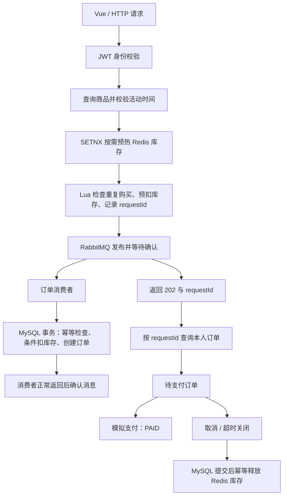

# Flash Sale Platform｜前后端分离秒杀平台

基于 Spring Boot 与 Vue 3 的个人学习项目，围绕商品秒杀实现用户认证、商品管理、Redis 库存预扣、RabbitMQ 异步订单、模拟支付、取消与超时关闭，以及管理员数据看板。

后端采用 Controller → Service → Repository 分层。Redis 缓存减少热点商品查询，Lua 原子执行库存与重复购买检查，消费者在 MySQL 事务中完成最终扣库存与订单创建。

## 功能概览

| 模块 | 已实现功能 |
|---|---|
| 用户认证 | 注册、BCrypt 密码校验、JWT 登录、当前用户查询 |
| 权限控制 | 业务接口登录校验、管理员路径拦截、本人订单访问限制 |
| 商品管理 | 商品列表与详情、新增、完整编辑、快速上下架、库存与活动排期修改限制 |
| 商品缓存 | 列表摘要与详情缓存、更新后失效、短期空值缓存、随机 TTL、读取连接失败回退 MySQL |
| 秒杀 | 活动时间检查、SETNX 按需预热、Lua 原子预扣、防重复购买、requestId 关联 |
| 异步下单 | RabbitMQ 发布确认与退回检查、消费者事务下单、重复消息幂等、有限重试与死信 |
| 订单 | 我的订单、请求结果查询、模拟支付、主动取消、支付超时关闭 |
| 库存释放 | MySQL 提交后幂等释放 Redis 库存与旧购买标记，支持关闭订单后重购 |
| 数据统计 | 商品与库存、各状态订单、已支付金额、支付转化率、请求受理统计 |
| 前端 | 登录注册、商品展示、秒杀与结果查询、订单操作、管理员商品管理与统计看板 |

## 技术栈

| 类别 | 技术 |
|---|---|
| 后端 | Java 21、Spring Boot 3.2.8、Spring MVC、JdbcTemplate、HikariCP、Lombok |
| 存储 | MySQL 8.0、Redis 7.2 |
| 消息与并发 | RabbitMQ 3.13、Redis Lua、MySQL 行锁与唯一约束 |
| 认证 | JWT、BCrypt、Spring MVC 拦截器 |
| 前端 | Vue 3、Vite、Vue Router、Pinia、Axios、Element Plus |
| 工具 | Maven、Docker Compose、JUnit、Vitest、JMeter |

## 核心流程



**商品缓存：** 列表返回摘要，详情返回完整商品；正常缓存 TTL 为 500～530 秒，不存在或下架的商品使用 30 秒空值标记。编辑及上下架删除列表和对应详情缓存，新增删除列表缓存。随机 TTL 降低集中失效概率，不能替代完整的雪崩防护。

**异步订单：** Redis 用于资格预扣，MySQL 保存最终库存和订单。消费者事务中执行条件扣减与订单插入，插入异常时回滚 MySQL 扣减。相同 requestId 的重复消息核对用户、商品和金额后返回原订单，避免重复扣库存。

**订单关闭：** 取消和超时先在 MySQL 事务中更新状态并归还库存，再通过 Lua 释放 Redis 库存。释放标记防止重复增加，删除购买标记时比较旧 requestId，避免误删用户重购的新标记。

```text
PENDING_PAYMENT
    ├── 模拟支付 → PAID
    ├── 主动取消 → CANCELLED
    └── 支付超时 → PAYMENT_TIMEOUT
```

## 项目目录

```text
flash-sale-platform/
├── src/main/java/com/example/flashsale/
│   ├── auth/          # JWT 与管理员认证
│   ├── config/        # Web 与基础配置
│   ├── user/          # 用户注册与查询
│   ├── product/       # 商品管理与缓存
│   ├── seckill/       # 秒杀入口、Lua 库存与结果查询
│   ├── messaging/     # RabbitMQ 生产者与消费者
│   ├── order/         # 订单、支付、取消与超时
│   └── analytics/     # 管理员统计
├── src/main/resources/ # 配置与统计 Lua
├── src/test/            # 后端测试
├── frontend/           # 独立 Vue 工程
├── sql/                # 建表、演示数据与升级 SQL
├── docker-compose.yml
└── pom.xml
```

## 本地启动

### 环境要求

- JDK 21、Maven 3.9.x。
- Node.js 20.19+ 或 22.12+，推荐受支持的 LTS 版本。
- Docker Desktop 与 Docker Compose。

### 获取代码

```bash
git clone https://github.com/Zwy7q/flash-sale-platform.git
cd flash-sale-platform
```

### 启动基础服务

```bash
docker compose up -d mysql redis rabbitmq
docker compose ps
```

| 服务 | 本机地址 | 本地教学账号 |
|---|---|---|
| MySQL | localhost:3307，数据库 flash_sale | root / root123456 |
| Redis | localhost:6379 | 无密码 |
| RabbitMQ | localhost:5672 | flashsale / flashsale123456 |
| RabbitMQ 管理页面 | [localhost:15672](http://localhost:15672) | 同上 |

MySQL 容器内部使用 3306，映射到主机 3307。首次创建数据目录时自动执行 sql/ 初始化；已有 volume 重启不会再次执行 SQL。

已有旧订单表需先备份并核对结构，再使用 sql/009_order_repurchase_and_timeout.sql 升级。Windows PowerShell 执行示例：

```powershell
Get-Content -Raw -Encoding UTF8 ./sql/009_order_repurchase_and_timeout.sql | docker exec -i flash-sale-mysql mysql --default-character-set=utf8mb4 -uroot -proot123456 flash_sale
```

该升级依赖订单表已存在，不负责修复任意手工修改后的结构；不要删除数据 volume 来升级。

### 启动后端

```bash
mvn spring-boot:run
```

也可以在 IDEA 导入 pom.xml，选择 JDK 21，运行 com.example.flashsale.FlashSaleApplication。

后端地址为 localhost:8080；[健康接口](http://localhost:8080/api/health) 返回 OK 只说明 Web 入口可用，依赖连接还需实际业务请求验证。

### 启动前端

另开终端：

```bash
cd frontend
npm ci
npm run dev
```

访问 [localhost:5173](http://localhost:5173)。Vite 开发代理将 /api 转发到后端 8080。

当前前端另有可选智能客服入口，连接独立 Python 服务（默认 8000 端口）。该服务不属于本仓库的 Java 后端，未启动它不影响商品与订单主流程。

### 账号与活动配置

先注册自己的账号再登录。管理员由 src/main/resources/application.yml 中的 app.admin-user-id 指定，默认 ID 为 1；普通注册不会自动获得管理员权限。可以将该配置改为自己的真实用户 ID，再重启后端体验管理功能。

商品种子排期可能已过期，请通过管理页面按当前时间调整未开始活动。默认订单支付期限为 900 秒，超时扫描间隔为上次执行结束后 60000 毫秒。

受保护接口使用：

```http
Authorization: Bearer <登录返回的Token>
```

基础服务账号和 JWT 密钥是公开的本地教学配置，实际部署需替换，不提交个人凭据或真实 Token。

## 主要接口

下表为主要接口，商品详情、订单详情等路径中的 ID 均使用真实数据。

| 方法 | 路径 | 用途 |
|---|---|---|
| POST | /api/users | 注册 |
| POST | /api/auth/login | 登录 |
| GET | /api/users/me | 当前用户 |
| GET | /api/products | 上架商品摘要 |
| GET | /api/products/{id} | 商品详情 |
| GET | /api/admin/products | 管理员商品列表 |
| POST | /api/admin/products | 新增商品 |
| PUT | /api/admin/products/{id} | 完整编辑 |
| PUT | /api/admin/products/{id}/status | 上下架 |
| POST | /api/seckill/products/{productId} | 提交秒杀 |
| GET | /api/seckill/requests/{requestId} | 查询本人异步结果 |
| GET | /api/orders | 我的订单 |
| GET | /api/orders/{id} | 本人订单详情 |
| POST | /api/orders/{id}/pay | 模拟支付 |
| POST | /api/orders/{id}/cancel | 取消待支付订单 |
| GET | /api/admin/analytics/overview | 统计总览 |
| GET | /api/admin/analytics/products | 商品统计 |
| GET | /api/admin/analytics/products/{id} | 指定商品统计 |

登录请求体：

```json
{
  "username": "你的用户名",
  "password": "你的密码"
}
```

新增与完整编辑商品的请求体示例（活动时间需调整）：

```json
{
  "name": "示例商品",
  "description": "用于本地演示",
  "price": 299.00,
  "seckillPrice": 129.00,
  "stock": 100,
  "seckillStock": 30,
  "status": 1,
  "seckillStartAt": "2027-01-01T10:00:00",
  "seckillEndAt": "2027-01-01T12:00:00"
}
```

秒杀、支付和取消不需要请求体；上下架提交 {"status": 0} 或 {"status": 1}。注册提交 username、password、nickname。

秒杀返回 202 + SUCCESS 表示受理，不等于订单已落库。客户端保存 requestId 再查询；RESULT_UNKNOWN 只表示目前没查到本人订单，不能确定任务仍在排队。

## 测试与构建

项目根目录：

```bash
mvn test
mvn package -DskipTests
```

frontend 目录：

```bash
npm test
npm run build
```

部分后端测试需要真实中间件与隔离数据；默认 mvn test 不代表所有 *IT 集成测试都已执行。写入型测试不要直接使用需要保留的演示数据。

前端产物在 frontend/dist，后端产物在 target。静态部署时需要托管 dist 并配置 /api 反向代理与 Vue 路由回退，Vite 开发代理不等于生产代理配置。

## 当前边界与后续方向

- 支付是模拟状态更新，没有接入第三方渠道。
- 管理员使用固定 ID 配置，没有动态角色权限体系。
- Redis 预扣、RabbitMQ 发布与 MySQL 下单不是同一个原子事务；发送未知时保留预扣，通过 requestId 查询和人工核对，尚无 Outbox 或可靠发送任务表。
- 消费总计最多尝试 3 次，间隔 500ms，耗尽进入死信；没有自动死信恢复或发布失败库存补偿。
- 已关闭订单的 Redis 释放有重试机制，库存缺失或核对标记需人工处理。
- 缓存删除与数据库提交仍有并发回填窗口，没有完整限流与互斥缓存重建。
- 统计不是跨 MySQL/Redis 的同一时刻快照，请求计数也可能因 Redis 故障漏记。
- 默认 Compose 没有给 Redis 挂载持久数据卷，数据丢失后不能盲目按 MySQL 库存覆盖在途预扣。

本项目用于学习和展示真实实现，不以短时本机测试推断生产容量，也不宣称全故障下零丢单。
